<div align="center">


# Bolton Vouched

**Local people, vouched for by Bolton.**

The tradespeople Bolton's WhatsApp group recommends, in one place, with the checks we've made.
Pick a trade and an area, then call or WhatsApp them in one tap. No sign-up, no cookies to look
or call; sign in with Google or a code sent to your email to leave a review.

Made by YSB Designs, a trading name of YSB Ventures Ltd.


</div>

<br/>

> [!NOTE]
> **Reading this without a technical background?** Start at *The problem*, *What's
> in it* and *One request, end to end*. Those three explain what Bolton Vouched is
> and what it does for someone who needs a plumber. Everything after *How the
> pieces fit* is for whoever maintains the code.

### How to read the diagrams

Every picture in this file uses the same four colours, and they always mean the
same thing. The connectors animate, so you can see which way the information
actually travels.

| | Means |
| :--- | :--- |
| 🟥 **Brick, gold border** | Bolton Vouched itself: our code and our database |
| 🟩 **Pale sage** | Built and live today |
| 🟨 **Sand, dashed border** | In development: not built, not described as built |
| ⬜ **Stone** | A person, or something outside Bolton Vouched |

---

## The problem, in one picture

Every week someone in the Bolton Tradesmen WhatsApp group asks *"anyone know a
good…?"*. The answers are good: real people, recommended by neighbours who've
used them. Then they scroll away under a few hundred messages, and the next
person asks again.



Bolton Vouched keeps those answers **where you can find them**: the people the
group recommends, sorted by trade and by the BL areas they cover, with what
we've checked about them (ID, insurance, Gas Safe, DVSA and so on) and a button
to call or WhatsApp them. Every trader on it has agreed to be listed.

> [!TIP]
> **Nobody can pay to move up the list.** That sentence is the product. A listing
> is free for good, and money will never change where anyone appears.

---

## What's in it

One site, free for residents and free for traders.


**Live today**

- **The showcase site** at `/`: what Bolton Vouched is, how to add it to a phone,
  how traders get listed, and the FAQ. This is the link to share.
- **The directory** at `/platform`, which installs to the Home Screen as an app
  (a PWA, `app/manifest.ts`). Old links (`/c/…`, `/p/…`, `/consent/…`) forward to it.
- **43 categories in seven groups**: home and trades, repairs and appliances,
  moving and waste, events, personal and lessons, vehicles, and transport (taxis
  and private hire, minibus hire, airport transfers).
- **Provider profiles** with the areas they cover and the checks we've recorded.
  Gas & boilers can't go live without a Gas Safe check; driving instructors need
  a DVSA ADI check.
- **Call and WhatsApp** buttons that go through `/api/contact`, which counts each
  tap as an enquiry and then hands over to the phone or WhatsApp. **The numbers
  are never in the page's HTML.**
- **Consent links**: a trader is listed only after they open their link, read
  exactly how they'll appear, and agree. What they agreed to is kept as evidence.
- **Sign-in** at `/platform/sign-in`: **Continue with Google** (PKCE, back through
  `/platform/auth/callback`) or a **6-digit code sent by email** (works inside the
  home-screen app). Throwaway email domains are refused, codes are rate-limited per
  address and per connection and capped under Resend's free tier, and reviews from
  email-only accounts wait for the admin's approval. Texted codes are still in the
  code but switched off (`SIGN_IN_PHONE`, see *Phone sign-in* below).
- **Reviews** at `/platform/p/<slug>/review`: one screen of taps, live at once
  ("Published", or "Published, under a quick check" when an anti-fake rule trips),
  editable for 14 days, with an optional private proof photo or PDF (location data
  stripped). Profiles list them with Verified job and Group member filters, and the
  category list ranks anyone with three or more by their quality score.
- **Provider replies** at `/platform/provider`: the admin sends a trader a
  single-use **trader sign-in link** (`/platform/link/<token>`, 14 days); they open it
  signed in and their account is linked to the listing. Then they reply once to each review.
- **Report** on every review, and **My reviews** and **Delete account** at
  `/platform/account` (reviews come down; the number is kept privately for 12 months).
- **Admin** at `/admin`, for the owner only: add and edit providers, record
  checks, copy consent links, set live, pause or remove; clear or remove reviews
  under check (with a logged reason), resolve flags and reports, and accept proofs.

**Coming, and not built**

- Community questions.
- Trader dashboards.
- The optional paid **Verified** tier (see *Free and Verified*).

> [!IMPORTANT]
> **Only the green boxes are built.** Never claim community questions, dashboards
> or Verified exist before they do: not on the site, in the WhatsApp group, in a
> message to a trader or on a listing. Say *coming soon*, or say nothing.
> `tests/unit/no-stale-claims.test.ts` fails if old "reviews are coming" wording
> comes back.

---

## One request, end to end

The clearest way to explain the site is to follow one ordinary request.


Two details that matter more than they look:

- **The button is a link to our server, not to a number.** `/api/contact/<slug>?via=whatsapp`
  looks the number up on the server, logs the tap, and answers with a redirect to
  `wa.me/…` (or `tel:…` for Call). Scrapers reading the page find no phone numbers.
- **One enquiry per device per day.** Ten taps from the same phone on the same
  day count once, so the enquiry count is hard to inflate, for or against
  anyone. The count works on a salted hash, never on the IP address itself.

---

## How the pieces actually fit

This is the technical picture. **The browser only ever talks to our Next.js
server, and the server only ever reads providers through one view.**



| Piece | What it does |
| :--- | :--- |
| **Browser or PWA** | The showcase at `/`, the directory at `/platform`. No account, no cookies |
| **`boltonvouched.ysbdesigns.uk`** | A CNAME at the `ysbdesigns.uk` DNS pointing at Railway |
| **Next.js 16 on Railway** | Service `web`, deployed from `main`. Server components read the database; nothing in the browser holds a key that matters |
| **`provider_public`** | The only public door to provider data. Live providers only, and no phone, billing, consent or document columns |
| **`private.*`** | `SECURITY DEFINER` wrappers the view calls, in a schema the public role can't even name |
| **`admin_*` functions** | Every admin write: checks the caller is an admin, then writes one `audit_log` row |
| **Postgres with RLS** | Row-level security on every table; the public roles have every default grant stripped |
| **Supabase Auth** | Google sign-in and 6-digit email codes (sent through Resend's SMTP) for residents and traders; email and password for the admin. A trigger on `auth.users` refuses password sign-ups and any email account the app's sign-in gate didn't approve (except the admin list). Texted codes are kept but off |
| **GitHub Actions** | Lint, types, unit tests, pgTAP database tests and browser tests on every push and pull request |

### Why the public view, and why numbers never reach the page

It was a decision, not a shortcut. A directory of tradespeople's mobile numbers
is exactly what spammers and scrapers want, and a trader who gets cold-called
because they listed with us won't stay listed.

So the public side of the site can only see one thing, `provider_public`, and
that view simply doesn't have the phone columns. Even a bug in a page can't
leak a number, because the page never had it. The only code that reads a
number is `/api/contact`, on the server, with the service key, at the moment
someone taps the button, and what it sends back is a redirect, not a page.

What it costs, said plainly:

- **No number to copy from the page.** A resident who wants to save a number
  saves it from their call log or WhatsApp, like any other contact.
- **Every tap is a round trip** to our server before the phone or WhatsApp
  opens. It's a fraction of a second, and it's what makes the enquiry count honest.

> [!IMPORTANT]
> **Never expose phone, billing, consent or document columns** through
> `provider_public`, a new view, a new function the public roles can call, or a
> page's props. **Never add trackers, analytics, pixels, chat widgets or cookies
> to public pages.** The only cookies on the site are sign-in cookies, and
> `proxy.ts` is scoped to `/admin` and the signed-in `/platform` routes (sign-in,
> account, review form, report, provider area) so public pages stay cookie-free.
> The theme choice lives in `localStorage` for the same reason.

### Where data goes

Only where it has to.


| When… | What's kept | Where |
| :--- | :--- | :--- |
| Someone looks around | Nothing. No cookies, no account, no analytics | Nowhere |
| Someone taps Call or WhatsApp | A salted hash of the device (HMAC with `DEVICE_HASH_SECRET`) and which trader. Not the IP, not their number | `contact_events`, readable only by the service role |
| A trader agrees to be listed | The IP, the consent text version and a SHA-256 of the exact text they were shown | The provider's consent evidence |
| Someone signs in | Their email address, and their Google account ID if they use Google (in Supabase Auth), the name they show ("Sarah K."), their postcode district (never public); sign-in attempts (the address or number entered, in plain text, with a hashed connection signature) for up to 30 days; an unconfirmed email account (code asked for, never used) for up to 24 hours; after deleting their account, only a peppered hash of their sign-in for 12 months | `auth.users`, `profiles`, `email_requests`, `identity_retention` |
| Someone posts a review | The answers, a salted device hash to catch fake reviews, and an optional proof file with its metadata stripped, seen only by the admin | `reviews`, `review_proofs`, the private `review-proofs` bucket |
| Someone deletes their account | Their reviews and replies come down; their number is kept for 12 months for legal claims, readable only by the database owner | `phone_retention` |
| The admin changes anything | Who, what, when and the reason | `audit_log` |

---

## The stack, in four layers

Left to right: what gets written, what it becomes, where that runs, and what it
hands the visitor off to.



| Layer | What and why |
| :--- | :--- |
| **TypeScript**, strict | Every file. A trader's listing is not a place for `undefined` |
| **Next.js 16** · React 19 | App Router and server components, so the database is read on the server. This Next.js has breaking changes from older versions; read `node_modules/next/dist/docs/` before changing framework code (see `AGENTS.md`) |
| **Tailwind 4** | The Bolton Brick palette as tokens in `app/globals.css`, light and dark |
| **Gloock** and **Figtree** | Through `next/font`, served from our own domain, so no request goes to Google |
| **Supabase Postgres** + RLS | Schema, view, functions and policies in `supabase/migrations/`, tested with pgTAP in `supabase/tests/` |
| **Supabase Auth** | Google and email-code sign-in (codes go to a local inbox in development and CI), phone sign-in behind `SIGN_IN_PHONE`, and the admin's email sign-in |
| **zod**, **libphonenumber-js** | Every admin form is validated; numbers are stored as E.164 |
| **Railway** | Service `web`, from `main` |
| **GitHub Actions** | `.github/workflows/ci.yml`: the checks above on every push and pull request |

---

## This repository

```
app/               the Next.js app: (site) showcase at /, platform/ directory,
                   admin/, api/contact/, (info) policy pages, manifest.ts
components/        UI: site/ (showcase), home/, category/, profile/, admin/, ui/
lib/               server code: directory reads, consent text, device hash, phone,
                   checks, Supabase clients
supabase/          migrations/, seed.sql (categories), tests/ (pgTAP)
e2e/               Playwright browser tests
tests/unit/        Vitest unit tests
scripts/           local stack, database reset and tests, screenshots, icons,
                   and the diagrams in this file
docs/design/       the Bolton Brick prototype the design follows
docs/launch/       the launch steps and the SQL to paste on launch day
assets/diagrams/   the diagrams in this file, as source and as SVG
public/            icons, showcase screenshots, the social preview image
```

### Running it locally

```bash
npm install
cp .env.example .env.local
npm run dev
```

`.env.example` holds the local defaults, identical for both local stacks below.

You need a local Supabase. With Docker:

```bash
npx supabase start
```

Local development also needs `psql` and `pg_prove` on your PATH (the database
scripts and `npm run test:db` use them).

Without Docker (sandboxes, some laptops), use the local Supabase-compatible
stack, which serves the same URLs, ports and keys. `scripts/local-stack/README.md`
explains what runs.

```bash
npm run stack:start   # idempotent: downloads binaries once, starts, waits until healthy
npm run stack:stop
```

`npm run db:reset` (the E2E setup runs it too) drops and rebuilds schema
`public`, applies every migration, then `supabase/seed.sql`. It is meant for the
local stack and needs a superuser. With the real Supabase CLI stack, set
`SUPABASE_CLI_STACK=1` (CI does) and it runs `npx supabase db reset --local`
instead. Both refuse non-local databases.

```bash
npm run lint
npm run typecheck
npm test              # Vitest unit tests
npm run db:reset && npm run test:db   # pgTAP: needs an empty register, so reset first
npm run test:stack    # the local stack's own guard and smoke tests
PW_CHROMIUM_PATH=/path/to/chrome npm run test:e2e   # Playwright; builds and serves the app (:3000, and :3001 with phone sign-in on)
npm run db:check-prod # the one-paste production scripts apply, in order, on a 000017-state database
```

The production pastes are generated from the migrations: `docs/launch/plan-2b-production.sql` (000018 to 000025),
`docs/launch/launch-checklist-production.sql` (000026), `docs/launch/review-source-production.sql` (000027) and
`docs/launch/availability-production.sql` (000028 on). After adding or changing a migration from 000028 on, regenerate with
`node scripts/build-production-sql.mjs --preset availability --from 20261012000028 --to <newest> --out docs/launch/availability-production.sql`
(`tests/unit/production-sql.test.ts` fails until you do).

Run `npm run test:db` straight after a reset: the scoring tests expect an empty
register, without the E2E fixtures. `npm run test:e2e` loads its own fixtures and
creates a local-only admin (`scripts/e2e-prepare.sh`); `PW_CHROMIUM_PATH` is only
needed to use a Chromium you already have.

CI (`.github/workflows/ci.yml`) runs lint, typecheck and unit tests in one job,
and in the other starts a **real** `supabase start`, resets, runs pgTAP, builds
and runs Playwright. The Docker-free stack is never used in CI.

### Admin sign-in

The admin area (`/admin`) uses Supabase email and password. Email sign-ups are
refused by the database unless the address is in `settings.admin_emails`. To
create the admin:

1. Add the address to the allow-list in the SQL editor:
   `update public.settings set value = value || '["admin@example.com"]'::jsonb where key = 'admin_emails';`
2. Supabase dashboard → **Authentication → Users → Add user** (email and
   password, auto-confirm).
3. In the SQL editor, give that user the admin role:

   ```sql
   insert into public.profiles (user_id, role)
   select id, 'admin' from auth.users where email = 'admin@example.com'
   on conflict (user_id) do update set role = 'admin';
   ```

### Deploying

| Where | What |
| :--- | :--- |
| **Railway**, project *Bolton Vouched* | Service `web`, deploying from `main`. Auto-deploy needs the **Railway GitHub app installed** on the repository; without it, pushes to `main` don't deploy |
| **Supabase**, project *Bolton Vouched* | London. Its own project, sharing **nothing** (keys, users, database, storage) with any other project |
| **DNS** for `ysbdesigns.uk` | `boltonvouched` CNAME to the Railway domain, plus Railway's `_railway-verify` TXT record |

Railway service variables:

| Variable | What it is |
| :--- | :--- |
| `NEXT_PUBLIC_SITE_URL` | `https://boltonvouched.ysbdesigns.uk`. Must be set, or consent links copied from admin are relative paths that don't work when sent to a trader |
| `NEXT_PUBLIC_SUPABASE_URL` | The Supabase project's API URL |
| `NEXT_PUBLIC_SUPABASE_ANON_KEY` | The anon (public) key |
| `SUPABASE_SERVICE_ROLE_KEY` | Server only. Needed by Call/WhatsApp, the consent page, sign-in, proof uploads and account deletion. Never put it anywhere else |
| `SIGN_IN_PHONE` | `off` (or unset). Only the exact value `on` shows sign-in by text and lets the Send SMS hook send; it needs the three Twilio variables and the hook secret below, which can otherwise be left out |
| `TWILIO_ACCOUNT_SID`, `TWILIO_AUTH_TOKEN` | Phone sign-in only. Server only. Twilio Lookup, which refuses internet and virtual numbers before a code is sent. `TWILIO_LOOKUP_STUB` must **not** be set in production |
| `SUPABASE_SMS_HOOK_SECRET` | Phone sign-in only. Server only. The signing secret Supabase shows for the **Send SMS hook** (`v1,whsec_…`). Without it the hook refuses every text (fail closed) |
| `TWILIO_MESSAGING_SERVICE_SID` | Phone sign-in only. Server only. The Twilio Messaging Service (`MG…`) the Send SMS hook texts codes through. `TWILIO_SMS_STUB` must **not** be set in production |
| `TURNSTILE_SITE_KEY`, `TURNSTILE_SECRET_KEY` | Cloudflare Turnstile (free) on "Email me a code" and the admin sign-in. The site key is public (shown to the browser), the secret is server only. Both unset: no check (local, CI). Only one set: every email-code request is refused (fail closed). Supabase's CAPTCHA uses the same secret (LAUNCH.md Step 3d) |
| `DEVICE_HASH_SECRET` | Server only. A long random secret (`openssl rand -hex 32`), never `change-me` |
| `TRUSTED_PROXY_HOPS` | Optional, default `1`. How many trusted proxies append to `X-Forwarded-For` in front of the app. Railway's edge appends the real client IP as the last entry, so the app reads the entry this many places from the right and ignores anything a visitor puts on the left. Only change it if another proxy (a CDN) is put in front of Railway |
| `OWNER_LEGAL_NAME` | `YSB Ventures Ltd`, matching Companies House character for character |
| `CONTACT_EMAIL` | `support@ysbdesigns.uk` |

`OWNER_LEGAL_NAME` and `CONTACT_EMAIL` are required: in production the consent
page fails closed without them and the build fails, because the policy pages are
prerendered with them. Redeploy after changing either. **Never give a secret a
`NEXT_PUBLIC_` prefix**: those are built into the browser bundle and are public.

In Supabase:

1. **Free sign-in (Google and email codes)**: follow *Owner actions* in
   `docs/superpowers/plans/2026-10-12-plan-2b-free-sign-in.md` (Resend as custom SMTP with
   sender `noreply@ysbdesigns.uk`; the **Confirm signup** and **Magic Link** templates from
   `supabase/templates/sign-in-code.html`; Email provider with **Confirm email on, always**,
   OTP length 6, expiry 900 seconds; emails sent per hour 30; CAPTCHA with Cloudflare Turnstile
   (`docs/launch/LAUNCH.md` Step 3d); the Google provider with the
   client from Google Cloud; Site URL and Redirect URLs on `https://boltonvouched.ysbdesigns.uk`).
   **"Allow new users to sign up" → on**: the database refuses password sign-ups and any
   email account the sign-in page didn't approve (`email_approve` / `bv_nonce`).
2. **Phone provider off, and the Send SMS hook off**, unless phone sign-in is switched
   on (see *Phone sign-in* below).
3. **Authentication → Rate Limits**: sign-ups and sign-ins, and token verifications, 150
   per 5 minutes. These are "per IP", but every request comes from Railway, so they are
   one bucket for the whole site. The app's own limits (`settings.email_limits`,
   `settings.otp_verify_limits`) stop one visitor from using them all up.
4. **Storage**: bucket `review-proofs` exists, is **private**, 10 MB, JPEG/PNG/WebP/PDF,
   no policies (the migration creates it when Storage is there).
5. **Apply migrations through the SQL editor**: paste each new file from
   `supabase/migrations/` in order and run it (`docs/launch/LAUNCH.md` → Step 3a
   lists them, with the checks to run). On launch day also run
   `docs/launch/finish-admin-function.sql`, before the first consent link goes out.
6. Create the admin as in *Admin sign-in*.

#### Phone sign-in (off by default)

Texted codes cost money, so they are switched off: `SIGN_IN_PHONE` unset or `off` hides
the phone form, the sign-in actions refuse and `/api/auth/sms-hook` answers 403. The
code, tables and tests stay (the E2E `phone` project runs them with the switch on).
To switch it back on, set the Twilio variables and the hook secret, `SIGN_IN_PHONE=on`, and in Supabase:

1. **Authentication → Sign In / Providers → Phone**: on. Fill in the SMS provider
   (Twilio Verify is fine): Supabase needs one configured, but once the Send SMS
   hook (step 3) is on, the hook sends every text instead. No test numbers in
   production. **"Allow new users to sign up" → on** (phone sign-up needs it; the
   database refuses unapproved email sign-ups). **Phone confirmations ("Confirm phone") →
   on, always**: the database refuses a phone account that arrives already
   confirmed, so with it off nobody can sign up. Leave the **Email** provider on,
   or the admin can't sign in. A new phone account is only accepted with the
   single-use code the sign-in page hands to Supabase (`otp_approve` /
   `bv_nonce`), and phone-only accounts can never use a password, so Supabase's
   own `/signup` endpoint can't be used to create or pre-claim an account.
2. **Authentication → Rate Limits**: SMS sent per hour **30** (the owner's choice, launch
   day included: it is project-wide and the only Supabase-side ceiling on texts); sign-ups and sign-ins,
   and token verifications, 150 per 5 minutes. These are "per IP", but every request
   comes from Railway, so they are one bucket for the whole site. The app's own
   wrong-code limit (5 per number per 15 minutes, 20 per connection per hour,
   `settings.otp_verify_limits`) stops one visitor from using them all up.
3. **Authentication → Hooks → Send SMS hook → HTTPS**, URL
   `https://boltonvouched.ysbdesigns.uk/api/auth/sms-hook`. Generate the secret and
   put it in Railway as `SUPABASE_SMS_HOOK_SECRET`; set `TWILIO_MESSAGING_SERVICE_SID`
   (see *Texts and the SMS bill* below). Turn the hook on **after** Railway has
   redeployed with both variables.

#### Texts and the SMS bill

The app's limits (3 codes per number per 15 minutes, 10 per connection per hour,
counting an IPv6 connection's whole /64 as one,
and the monthly cap in `settings.sms_monthly_cap_gbp`, £20 by default) only see
texts that go through the sign-in page. The cap counts Twilio Lookups too: every
request that gets past the limits costs a Lookup (`settings.lookup_cost_gbp`, £0.01)
as well as a text if one goes (`settings.sms_cost_per_send_gbp`, £0.10). Supabase's own API can also text an
existing account directly with the public key. Two things close that:

- **The Send SMS hook (step 3 above).** With it on, Supabase hands every text to
  `/api/auth/sms-hook` instead of sending it. The app sends only for a request
  the sign-in page approved in the last 5 minutes, once per request
  (`sms_hook_gate`), so every text passes the limits, the Lookup and the cap.
  Anything else gets a refusal and no text. With the hook on, codes are sent by
  **Twilio Programmable Messaging** through a Messaging Service (UK alphanumeric
  sender `BoltonVouch`, *SMS Pumping Protection* on), and Supabase checks the
  codes itself, so Twilio Verify is no longer used. With the hook **off**, the
  app's cap is **not** a hard cap: direct texts are limited only by Supabase's
  hourly rate limit and by Twilio.
- **Twilio itself is the only true hard stop**, hook or not:
  - pay as you go with **prepaid credit and auto-recharge OFF**. When the balance
    runs out, texts stop. A usage trigger only sends an email;
  - a **usage alert** (Console → Monitor → Usage triggers) at £10 and £20 a month
    on SMS and Lookup, emailing the owner;
  - **Geo permissions: United Kingdom only** for SMS;
  - keep Supabase's **SMS sent per hour** at 30.

#### Group code and proof files

- The group code (Group member badge) allows **5 wrong tries per person in 24
  hours**, enforced in the database (`settings.group_code_limits`); after that the
  person sees a plain message and can try again the next day.
- **Proof files are deleted 12 months after the admin checks them** (the privacy
  notice says so; `settings.proof_retention_months`). `proof_files_due` and
  `mark_proof_files_deleted` (admin or service role) find and mark them;
  `lib/proof-retention.ts` deletes the Storage files in between. The review keeps
  its Verified job label. For now the admin runs it from **Proofs → Old proof
  files** once a month; a scheduled job belongs to Plan 5.

**Never run `supabase config push`**: `supabase/config.toml` holds dummy Twilio
settings and test phone numbers for local use and CI only.

`docs/launch/LAUNCH.md` has the launch morning step by step.

> [!CAUTION]
> **The custom domain lives in two places.** Railway serves the site at
> `boltonvouched.ysbdesigns.uk` because of the custom domain on service `web`
> **and** the CNAME at the domain's DNS. `NEXT_PUBLIC_SITE_URL` builds every consent
> link from it. Change the domain and update all three in the same change, or
> consent links point at a dead address. Consent links already sent use the old
> address, so keep it forwarding. The `CNAME` file in this repo is left over from
> GitHub Pages, which can't run this app; Pages should stay off.

### Where things live

| What you want to change | File |
| :--- | :--- |
| The showcase site's words and FAQ | `components/site/content.ts`, `app/(site)/page.tsx` |
| The directory home | `app/platform/page.tsx`, `components/home/` |
| A category page and the area filter | `app/platform/c/[category]/page.tsx`, `components/category/AreaFilter.tsx` |
| Which postcode areas are offered | `lib/districts.ts` |
| A provider's profile | `app/platform/p/[slug]/page.tsx`, `components/profile/` |
| How checks are shown | `lib/checks.ts`, `components/profile/ChecksList.tsx` |
| The Call and WhatsApp buttons | `components/profile/ActionBar.tsx` |
| Logging a tap and redirecting | `app/api/contact/[slug]/route.ts` |
| The device hash | `lib/device-hash.ts` |
| The consent wording and its version | `lib/consent-text.ts` |
| The consent page | `app/platform/consent/[token]/` |
| Sign-in (Google, email code, phone) and Welcome | `app/platform/sign-in/`, `app/platform/welcome/`, `lib/email-gate.ts`, `lib/email.ts`, `lib/sign-in-methods.ts`, `lib/otp-gate.ts`, `lib/line-type.ts` |
| The Google sign-in callback | `app/platform/auth/callback/route.ts`, `lib/google-callback.ts` |
| Trader sign-in links (linking a trader to their listing) | `app/platform/link/[token]/`, `lib/trader-link.ts`, `supabase/migrations/20261012000022_trader_links.sql` |
| The sign-in code email | `supabase/templates/sign-in-code.html` (pasted into Supabase's templates) |
| Throwaway email domains | `lib/disposable-email-domains.json`, `scripts/disposable-domains-sql.mjs` |
| The account page, My reviews, Delete account | `app/platform/account/`, `components/account/` |
| The review form and proof uploads | `app/platform/p/[slug]/review/`, `components/review/`, `lib/review-form.ts`, `lib/proofs.ts` |
| Reviews on profiles | `components/profile/ReviewList.tsx`, `lib/reviews.ts` |
| The provider area (replies) and Report | `app/platform/provider/`, `app/platform/report/[reviewId]/` |
| Review moderation | `app/admin/(protected)/reviews/`, `flags/`, `proofs/` |
| Posting rules and the anti-fake checks | `supabase/migrations/20261012000004_review_posting.sql`, `…000005_review_flags.sql` |
| Admin pages and actions | `app/admin/(protected)/`, `lib/admin.ts` |
| Categories and groups | `supabase/seed.sql`, then a new migration for the live database |
| What the public can read | `supabase/migrations/20261011000003_public_view_rls.sql` |
| Enquiry logging and counting | `supabase/migrations/20261011000004_contact_events.sql` |
| Admin functions and the audit log | `supabase/migrations/20261011000005_admin_consent.sql` |
| Privacy, terms, how ratings work, review and fake-reviews policies | `app/(info)/`, `components/PolicyPage.tsx` (the draft banner) |
| Owner and contact on the policy pages | `lib/policy-config.ts` |
| Old-link redirects | `next.config.ts` |
| Sign-in session cookies, signed-in routes only | `proxy.ts` |
| Installing to the Home Screen | `app/manifest.ts`, `scripts/make-icons.mjs` |
| Colours and type, light and dark | `app/globals.css`, `app/layout.tsx` |
| The showcase screenshots and social image | `scripts/shots.mjs` |

---

## Free and Verified

| | |
| :--- | :--- |
| **Residents** | Free. No account, no sign-up |
| **A basic listing** | Free, for good |
| **Verified**, optional (*not built*) | £10 a month or £100 a year, offered to a trader after their 5th enquiry |

Rules that hold whatever happens with Verified:

- **The basic listing is free forever.** Nobody is removed, hidden or moved down
  for not paying.
- **Payment never affects ranking.** A trader's place in the list will come from
  reviews only. Whatever Verified ends up including, it never includes a position.
- **Verified is offered, never pushed.** Only after five enquiries, so it's
  offered to traders the site is already working for.

> [!NOTE]
> **None of Verified is built.** There's no payment, no badge for sale and no
> offer in the code today. The enquiry threshold is stored (`enquiry_threshold`
> in `settings`), ready for when it is.

---

## When something goes wrong

Most problems are a listing problem, and the owner fixes those in admin. The
rest is a bug, and a fix reaches everyone, not only the person who reported it.


### Who fixes what

| It is… | Who | How |
| :--- | :--- | :--- |
| A wrong detail on a listing | **The owner**, in admin | Edit the provider; it's in the audit log |
| A trader wants to come off | **The owner**, in admin | Removed within one working day of asking |
| A complaint about a trader | **The owner** | Pause the listing in admin while it's looked into |
| A reported or flagged review | **The owner**, in admin → Reviews / Flags | Clear it, or remove it with a reason (kept in the audit log). Never because a trader disagrees |
| A page that breaks, a wrong count | **Whoever maintains the code** | Reproduce, add a failing test, fix, merge to `main` |
| The site is down | **Whoever maintains the code** | Railway's deploy logs for service `web`, then Supabase's status |

Support is a ticket: email **support@ysbdesigns.uk**, or WhatsApp Business on
**07466 487591**. The site's contact links open an email with a
*Bolton Vouched: …* subject; the address is `CONTACT_EMAIL` in
`components/site/content.ts` and the `CONTACT_EMAIL` variable on Railway.

---

## Before launch

> [!WARNING]
> **The site doesn't show the registered office address yet.** The Companies Act
> requires a company's website to show its name, number and registered office.
> The name and number are on the site (`components/site/content.ts`). The
> registered office is the owner's home, so it stays off this public repo until
> the company moves to a registered office service; then add that address to
> the site footer and the privacy notice.

- [ ] **Legal review of the draft policy pages** (`/privacy`, `/terms`,
      `/how-ratings-work`, `/review-policy`, `/fake-reviews-policy`), then remove the *Draft — pending legal review* banner
      (`DRAFT_BANNER` in `components/PolicyPage.tsx`).
- [ ] **Register YSB Ventures Ltd with the ICO** (the data protection fee) as the
      controller for Bolton Vouched.
- [ ] **Set `OWNER_LEGAL_NAME` and `CONTACT_EMAIL`**, deploy, and check `/privacy`
      shows them.
- [ ] **Licence checks for taxis and private hire.** Before a taxi, minibus or
      airport-transfer listing goes live, check the council private hire or
      hackney licence (and an operator licence for minibuses with a driver) and
      record it as a check.
- [ ] **Build the 12-month purge of contact events.** The privacy notice states
      12-month retention; the job isn't built yet.
- [ ] **Delete old proof files monthly** (admin → Proofs → Old proof files) until
      Plan 5 schedules it.
- [ ] Run `docs/launch/finish-admin-function.sql` before sending the first consent
      link.
- [ ] **Free sign-in**: Resend verified for `ysbdesigns.uk`, Supabase SMTP and templates,
      Google OAuth client published, Google and Email providers set, Phone provider and
      the Send SMS hook off, `SIGN_IN_PHONE=off` on Railway, and
      `docs/launch/plan-2b-production.sql` pasted once before Plan 2b reaches `main`
      (*Owner actions* in `docs/superpowers/plans/2026-10-12-plan-2b-free-sign-in.md`;
      `docs/launch/LAUNCH.md` → Step 3b). Phone sign-in later needs the Twilio steps
      in *Texts and the SMS bill*.

---

## Before you change any copy

> [!CAUTION]
> **Never claim community questions, dashboards or Verified exist before they
> do.** Not on the site, not in a message to a trader, not in the WhatsApp group.
> They're *coming*. The same goes for every other feature in the sand boxes above.
> Reviews, replies, and Google and email sign-in are live, so say so plainly. Sign-in by
> text is switched off: don't tell anyone to sign in with their mobile.

Four more that catch people out:

- **Nobody can pay to rank.** Don't write anything that suggests money, Verified
  or anything else can move a trader up the list.
- **Any change to the consent wording bumps `CONSENT_TEXT_VERSION`** in
  `lib/consent-text.ts`. The version and a hash of the exact text are stored with
  each consent as evidence, so the wording and the version must always match.
- **No phone digits in public HTML.** Not in copy, not in a page's props, not in
  structured data. Numbers only leave through `/api/contact`.
- **Draft pages say they're drafts** until a solicitor has reviewed them.

British English throughout: *colour*, *licence* (the noun), *postcode*, and
prices in **£**.

---

## The diagrams

Seven SVGs, and the connectors animate. GitHub renders mermaid but can't animate
it, so these are built rather than inlined. The sources stay in the repo as text,
so a diagram is still something you can edit and diff:

```bash
assets/diagrams/*.mmd             # the source, one file per diagram
node scripts/build-diagrams.mjs   # regenerates the SVGs
```

The build script holds the palette and the animation in one place. It declares
the Bolton Brick colours light-first and redefines them under
`prefers-color-scheme`, so the diagrams follow GitHub's theme. It also keeps a
`prefers-reduced-motion` guard, so anybody who has asked their machine for less
movement gets a still picture, the same rule the site follows.

> [!NOTE]
> **Do not add a `font-family` override to that stylesheet.** Mermaid sizes every
> box for the font it measured with *before* the stylesheet is added, so changing
> the face afterwards clips the last line of a label.

Rendering uses mermaid-cli through `npx` and needs a Chromium. If the machine has
one already:

```bash
PUPPETEER_EXECUTABLE_PATH=/path/to/chrome node scripts/build-diagrams.mjs
```

---

## Licence

All rights reserved, YSB Ventures Ltd. Not open source. The Gloock and Figtree
fonts are under the SIL Open Font Licence, and every other library is under its
own licence.
